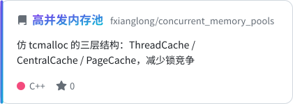
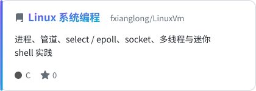
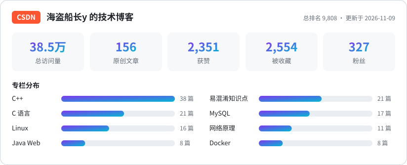
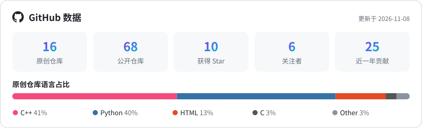

  
  
  

## 👋 关于我

<table>
<tr>
<td width="50%" valign="top">

**我在做什么**

- 🏭 工业设备监测软件：数据采集、振动指标、加工段分析、数字孪生
- 🖥️ 桌面端用 **C++ · Dear ImGui · OpenGL**，偶尔 Qt
- 🐧 顺手管着几台 Linux / Slurm 集群，踩过的坑都写进了博客
- 🤖 业余写 AstrBot 插件，最近在做基金记账与组合体检

</td>
<td width="50%" valign="top">

**我在写什么**

- ✍️ CSDN 博客 **156 篇原创**、**38 万+ 阅读**
- 📚 专栏：C++ · C 语言 · MySQL · Linux · 网络原理 · Docker
- 🔍 喜欢把「易混淆知识点」和「排错过程」讲清楚
- 💬 欢迎在博客或 Issue 里交流

</td>
</tr>
</table>

## 🛠️ 技术栈

  
  
  
  
  
  
  
  
  
   
  
  
  
  
  
  
  
  

## ✨ 精选项目

<a href="https://github.com/fxianglong/astrbot_plugin_fund_board"><picture><source media="(prefers-color-scheme: dark)" srcset="./assets/repo-astrbot_plugin_fund_board-dark.svg"/></picture></a>
<a href="https://github.com/fxianglong/concurrent_memory_pools"><picture><source media="(prefers-color-scheme: dark)" srcset="./assets/repo-concurrent_memory_pools-dark.svg"/></picture></a>
<a href="https://github.com/fxianglong/opencv-self-learning"><picture><source media="(prefers-color-scheme: dark)" srcset="./assets/repo-opencv-self-learning-dark.svg"/></picture></a>
<a href="https://github.com/fxianglong/LinuxVm"><picture><source media="(prefers-color-scheme: dark)" srcset="./assets/repo-LinuxVm-dark.svg"/></picture></a>
<a href="https://github.com/fxianglong/P2P-"><picture><source media="(prefers-color-scheme: dark)" srcset="./assets/repo-P2P--dark.svg"/></picture></a>
<a href="https://github.com/fxianglong/leetcode"><picture><source media="(prefers-color-scheme: dark)" srcset="./assets/repo-leetcode-dark.svg"/></picture></a>

## ✍️ 技术博客

<a href="https://blog.csdn.net/weixin_44826356"><picture><source media="(prefers-color-scheme: dark)" srcset="./assets/csdn-dark.svg"/></picture></a>

<table>
<tr>
<td width="50%" valign="top">

**🆕 最新文章**

<!-- CSDN-LATEST:START -->
- `2026-08-31` [麒麟系统部署 Windows 虚拟机全流程实战：从安装到扩容避坑指南](https://blog.csdn.net/weixin_44826356/article/details/164214184)
- `2026-05-09` [避坑指南：Ubuntu 启动报错 “Unable to mount root fs” 的深层诱因与修复](https://blog.csdn.net/weixin_44826356/article/details/160919417)
- `2026-01-29` [程序员必备工具：使用 cloc 统计项目代码量](https://blog.csdn.net/weixin_44826356/article/details/157515208)
- `2026-01-22` [解决 “Failed to start VNC server” 及 VNC 僵尸进程清理](https://blog.csdn.net/weixin_44826356/article/details/157251370)
- `2025-10-15` [Ubuntu 搭建 Samba 文件共享服务器完全指南](https://blog.csdn.net/weixin_44826356/article/details/153318855)
<!-- CSDN-LATEST:END -->

</td>
<td width="50%" valign="top">

**🔥 热门文章**

<!-- CSDN-HOT:START -->
- [SQL 多表查询常用语句总结](https://blog.csdn.net/weixin_44826356/article/details/131156745) · 4,518 阅读
- [Ubuntu 搭建 Samba 文件共享服务器完全指南](https://blog.csdn.net/weixin_44826356/article/details/153318855) · 3,494 阅读
- [Visual Studio 无法启动调试：未能处理配置文件](https://blog.csdn.net/weixin_44826356/article/details/142434684) · 3,090 阅读
- [了解 ceil 和 floor 函数：C++ 中的取整函数](https://blog.csdn.net/weixin_44826356/article/details/131178398) · 2,927 阅读
- [SQL 视图、存储过程、触发器](https://blog.csdn.net/weixin_44826356/article/details/131158642) · 2,300 阅读
<!-- CSDN-HOT:END -->

</td>
</tr>
</table>

## 📊 GitHub 数据

<picture><source media="(prefers-color-scheme: dark)" srcset="./assets/github-dark.svg"/></picture>

<picture>
  <source media="(prefers-color-scheme: dark)" srcset="https://raw.githubusercontent.com/fxianglong/fxianglong/output/snake-dark.svg"/>
  
</picture>

博客最新文章与各项数据由 GitHub Actions 每天自动更新 · <a href="https://blog.csdn.net/weixin_44826356">blog.csdn.net/weixin_44826356</a>

